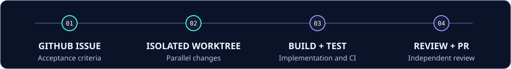
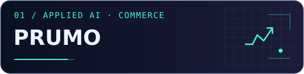
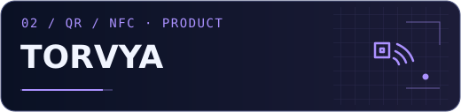
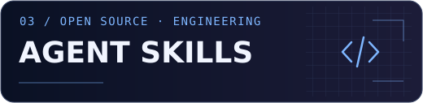
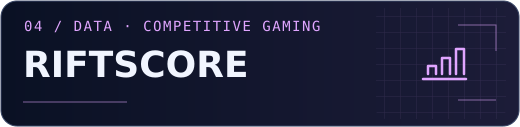

 

[Agent workflows](#01--agent-orchestration) · [Projects](#02--selected-projects) · [Technical skills](#03--technical-skills) · [Certifications & badges](#04--certifications--badges) · [Activity](#06--contribution-telemetry) · [Português](#em-português)

I coordinate IT operations in the financial cooperative sector and build products that apply AI to real workflows. My work spans infrastructure, identity and security governance, from keeping services reliable to designing automations that teams can test, review and operate.

## 01 / Agent orchestration

 

I use [Cezar](https://github.com/open-mercato/cezar) to coordinate coding agents across projects. Each task starts with acceptance criteria in GitHub. I assign agents to implementation and independent review, isolate changes in Git worktrees, and use reusable skills to carry project standards across runs.

I also work on AI inside products. In Prumo, AI helps rank offers and draft channel-specific posts, while publishing rules check prices and links against observed data. I track usage and set spending limits so the automation can run within a defined budget.

## 02 / Selected projects

<table>
<tr>
<td width="50%" valign="top">

  
Brazilian deals and price-tracking platform. I build the workflows that collect marketplace offers, validate discounts against price history, and publish deals and coupons to Telegram and WhatsApp.
</td>
<td width="50%" valign="top">

  
QR and NFC products that help small businesses collect Google reviews and share digital destinations. I work on the physical product, onboarding and the web platform that manages each tag.
</td>
</tr>
<tr>
<td width="50%" valign="top">

  
Public library of agent workflows for web design, accessibility, performance, visual QA, test-driven development and independent review.
</td>
<td width="50%" valign="top">

  
Analytics for a competitive gaming community, with automated match data collection, rankings and player insights.
</td>
</tr>
</table>

## 03 / Technical skills

I work across IT operations, security and software delivery in the financial cooperative sector.

| Area | Concepts & practices | Tools & platforms |
| --- | --- | --- |
| **Applied AI & agent orchestration** | Multi-agent workflows, task scoping, isolated Git worktrees, independent review, model usage and cost controls | Cezar, Claude Code, Codex, OpenCode, GitHub Actions |
| **Identity & Microsoft 365** | IAM and identity governance, MFA, Conditional Access, data loss prevention and access approval workflows | Microsoft Entra ID, Active Directory, Microsoft 365, Microsoft Defender for Office 365, SharePoint, Power Automate |
| **Defensive security** | Log analysis, SIEM and endpoint protection, incident response, vulnerability management and system hardening | Wazuh, Graylog, Nessus, Wireshark |
| **Infrastructure & service operations** | Network segmentation, site-to-site VPN, SD-WAN, virtualization, monitoring and IT service prioritization | FortiGate, Windows Server, Linux, Hyper-V, Zabbix, GLPI |
| **Security governance & resilience** | ISMS, ISO/IEC 27001 and 27002, NIST CSF, risk management, security awareness and business continuity | CISO Assistant, Eramba |
| **Software & automation** | API integration, scripting, relational databases, CI and deployment | Python, Bash, TypeScript, Next.js, PostgreSQL, Docker |

## 04 / Certifications & badges

**ISO/IEC 27001 Foundation** · Information security management systems.

<table>
<tr>
<td align="center" width="33%"> <a href="https://www.credly.com/badges/a692655c-e6e6-4f24-90cf-905ea99793b9/public_url">Fortinet FCF Cybersecurity</a></td>
<td align="center" width="33%"> <a href="https://www.credly.com/badges/e4039c04-39c5-47dd-a1fb-47d77e7961ec/public_url">Cisco Endpoint Security</a></td>
<td align="center" width="33%"> <a href="https://www.credly.com/badges/59101be6-3e45-4d6e-a48f-358d95ffd538/public_url">Cisco Introduction to Networks</a></td>
</tr>
</table>

Additional digital badges

- [Getting Started in Cybersecurity 2.0](https://www.credly.com/badges/85419a43-27a7-4edf-975e-a8cd91cd1d72/public_url)
- [Introduction to the Threat Landscape 2.0](https://www.credly.com/badges/fc4fd540-6521-432b-adce-d1ce2ed870ee/public_url)
- [ISC2 Candidate](https://www.credly.com/badges/d94e4db4-509a-4adb-8b82-5132c9ca4409/public_url)
- [Networking Academy Learn-A-Thon 2024](https://www.credly.com/badges/68a765a6-449a-40cc-a79d-bab2e626f4d2/public_url)

**Education** · BSc in Computer Science and postgraduate studies in Information Security.

Additional training

- Student SOC Program Foundations · Microsoft
- Santander Cybersecurity Bootcamp · DIO and Santander
- Hackers do Bem · Leveling, Basic and Fundamental tracks
- Cyber Resilience & Data Privacy · CNAC
- Python: Beginner to Advanced · Udemy

## Em português

Sou coordenador de TI no cooperativismo financeiro e atuo com infraestrutura, segurança da informação e governança de identidades. Uso o Cezar para orquestrar Claude Code, Codex e OpenCode em fluxos de desenvolvimento com testes e revisão independente. No **Prumo**, aplico IA à curadoria de ofertas e à criação de conteúdo. Na **Torvya**, desenvolvo produtos QR e NFC para conectar negócios aos seus clientes. Sou certificado em **ISO/IEC 27001 Foundation**.

Recent public GitHub activity

<!--START_SECTION:activity-->
1. 🎉 Merged PR [#4](https://github.com/emanuelmaraujo/skills/pull/4) in [emanuelmaraujo/skills](https://github.com/emanuelmaraujo/skills)
2. 🎉 Merged PR [#3](https://github.com/emanuelmaraujo/skills/pull/3) in [emanuelmaraujo/skills](https://github.com/emanuelmaraujo/skills)
3. 💪 Opened PR [#4](https://github.com/emanuelmaraujo/skills/pull/4) in [emanuelmaraujo/skills](https://github.com/emanuelmaraujo/skills)
4. 🎉 Merged PR [#2](https://github.com/emanuelmaraujo/skills/pull/2) in [emanuelmaraujo/skills](https://github.com/emanuelmaraujo/skills)
5. 💪 Opened PR [#3](https://github.com/emanuelmaraujo/skills/pull/3) in [emanuelmaraujo/skills](https://github.com/emanuelmaraujo/skills)
<!--END_SECTION:activity-->

## 06 / Contribution telemetry

